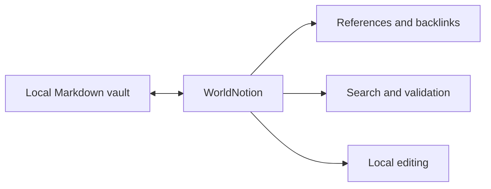

  

<h1 align="center">Everend WorldNotion</h1>

  Free, open-source desktop app for worlds stored as local Markdown. 
  Portable canon, rich references, and Everend Spec compatibility.

  <a href="README.es.md">Español</a> · <a href="https://github.com/SoleipDreams/everend-forge-worldnotion/releases/latest">Download free</a> · <a href="https://website-everend-forge.pages.dev/">Explore the integrated Suite</a>

  
  
  
  

WorldNotion is free to use on its own. The paid Suite is a separate integrated product; buying it does not change this app's open-source rights.

---

WorldNotion is a free, open-source Tauri + React + TypeScript desktop app for local-first worldbuilding.

## Product direction

WorldNotion is the canon and worldbuilding foundation of Everend Forge. Its longer-term direction covers connected story creation for video games, roleplaying, and literature, alongside PathBranching and Compendium. See [docs/PRODUCT_DIRECTION.md](docs/PRODUCT_DIRECTION.md) for the milestones and WorldNotion's role in each one.

## Current capabilities

- Open local vaults.
- Browse Markdown file trees.
- Render Markdown.
- Parse YAML frontmatter.
- Resolve wikilinks.
- Show backlinks.
- Search files and entities.
- Report broken links and missing required metadata.
- Edit and save Markdown files.
- Organize entities, properties, tags, images, tables, and live references without moving the vault out of local storage.
- Keep appearance preferences per universe and use the same vault from the standalone app or Everend Forge Suite.

## Development

~~~bash
npm install
npm run build
npm run tauri dev
~~~

Quality gates (all enforced in CI):

~~~bash
npm run typecheck
npm run lint
npm run format:check
npm run test:run
~~~

## Releases

Installers are produced by the `Release` GitHub Actions workflow: pushing a
`v*` tag (for example `v0.2.0`) builds Windows and Linux bundles with the
version from `src-tauri/tauri.conf.json` and attaches them to a draft GitHub
Release. Review the draft and publish it manually. Local packaging works with
`npm run tauri build`; see [CHANGELOG.md](CHANGELOG.md) for release notes.

Architecture and quality expectations are documented in [docs/ENGINEERING-PRINCIPLES.md](docs/ENGINEERING-PRINCIPLES.md). Future WorldNotion and Everend Forge suite work should preserve those defaults unless a change explicitly documents why the tradeoff is acceptable.

## Everend Forge Suite Compatibility

WorldNotion remains a standalone app and the owner of the canon Markdown vault experience. Everend Forge Suite mounts it as the World workspace while preserving the standalone desktop shell.

Suite integration treats vault files, frontmatter, wikilinks, taxonomy data, and `.everend` metadata as the durable contract. It does not depend on private React state or turn WorldNotion into the branching narrative editor.

## Fixture Vault

A deliberately empty placeholder vault lives in [examples/demo-vault](examples/demo-vault). It exists only for public testing and documentation. It is not derived from private canon.

## Related Repositories

- [Everend Forge portal](https://github.com/SoleipDreams/everend-forge)
- [Everend Spec](https://github.com/SoleipDreams/everend-forge-specs)
- [Everend PathBranching](https://github.com/SoleipDreams/everend-forge-pathbranching)
- [Everend Compendium](https://github.com/SoleipDreams/everend-forge-compendium)

## License

Code is licensed under either MIT or Apache-2.0; documentation is CC BY 4.0. Preserve required legal notices when redistributing. See [license scope](LICENSE), [MIT](LICENSE-MIT), [Apache-2.0](LICENSE-APACHE), [CC BY 4.0](LICENSE-CC-BY-4.0), and the separate [brand policy](TRADEMARKS.md).

## Support

If Everend Forge is useful to you, you can support its development on [Ko-fi](https://ko-fi.com/heinzdbv).

